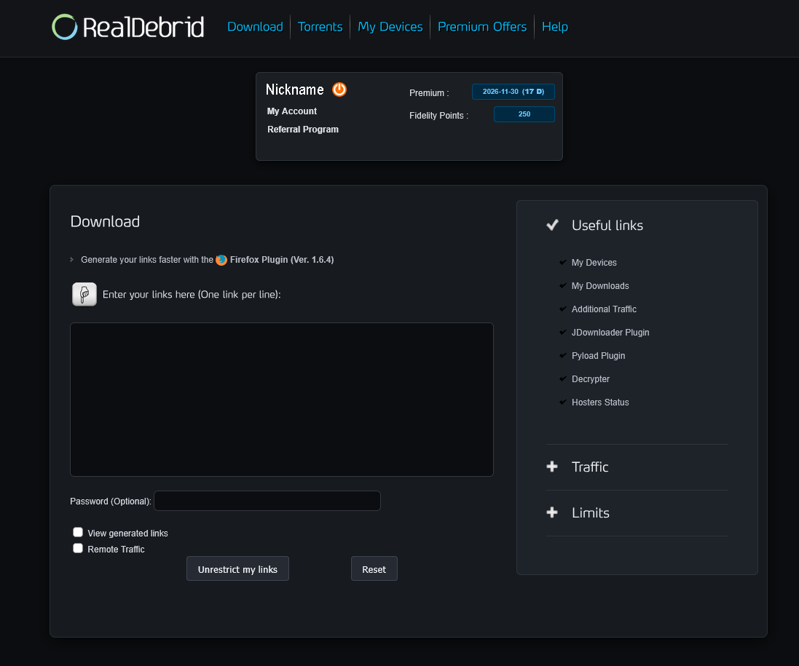

## Preview

# Real-Debrid Dark Theme

A comfortable, soft dark theme for [Real-Debrid](https://real-debrid.com/) designed to reduce eye strain without harsh pure-black contrasts.

## Features
- Soft dark gray palette (`#141517` / `#1e2024`) with gentle blue accents.
- Replaces legacy white image sprites with clean CSS cards and buttons.
- Covers Downloader, Torrents, My Devices, Premium Offers, Support, and Device Linking pages.
- Automatically excludes `api.real-debrid.com` to keep API documentation intact.

## Installation
1. Install the **Stylus** extension for [Firefox](https://addons.mozilla.org/ru/firefox/addon/styl-us/) or [Chrome](https://chromewebstore.google.com/detail/stylus/clngdbkpkpeebahjckkjfobafhncgmne).
2. **[Click here to install the theme](https://raw.githubusercontent.com/SlavaVas/real-debrid-dark-theme/main/real-debrid-dark.user.css)**
